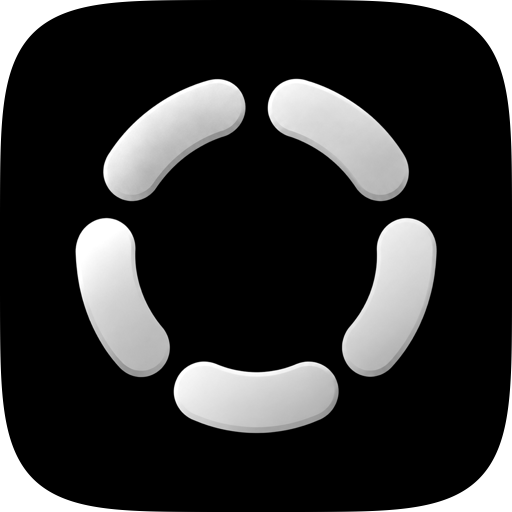
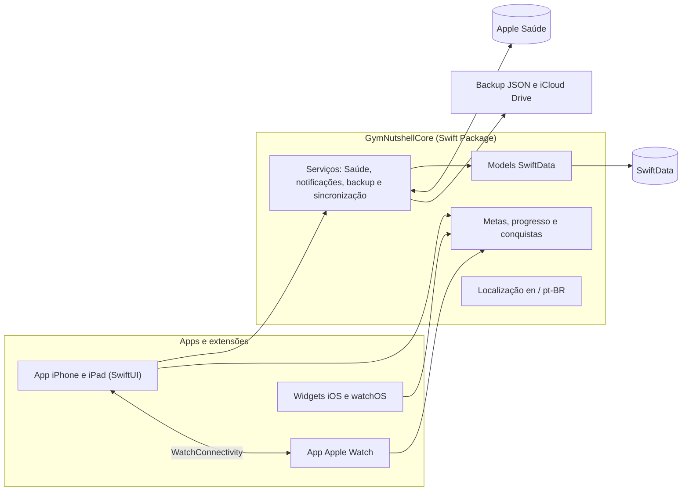
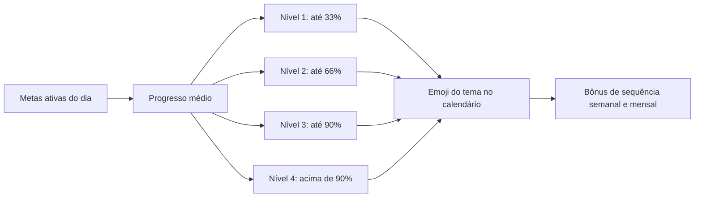
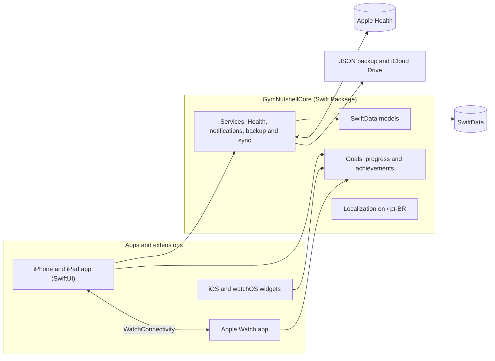
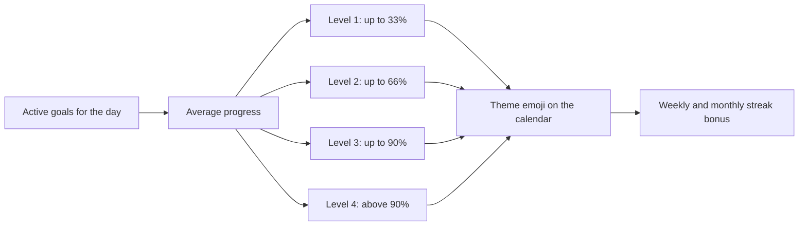

# &nbsp;&nbsp;Gym&nbsp;Nutshell&nbsp;&nbsp;

**[Read in English](#en-gymnutshell)**

_Rastreie metas de nutrição, sono, suplementos e libere conquistas._

O Nutshell nasceu da minha rotina de academia. Eu precisava lembrar de bater as metas de proteínas, carboidratos, água, sono e outros em um só lugar, mas não achei nenhum app que fizesse tudo isso junto.

Durante o dia, você rastreia cada meta com um slider simples, incluindo as metas padrões e outras metas personalizáveis, e recebe notificações ao longo do dia.

Para deixar o app um pouco mais divertido, cada dia completo vira uma conquista temática, com sequências e um calendário do seu progresso.

Ele é grátis, sem anúncios, sem assinatura e sem cadastro.

**Disponível na [App Store](https://apps.apple.com/us/app/gym-nutshell/id6774739305)** para iPhone, iPad, Apple Watch e Mac com Apple Silicon.

## Funcionalidades - Versão 1.0 
_(Algumas funcionalidades estão sendo removidas e outras aprimoradas na futura Versão 2.0. Qualquer dúvida ou sugestão entre em [contato comigo](https://jonathasmotta.com))_ 

**Hoje**
- Metas do dia com registro rápido e anel de progresso geral.
- Botão de dia de descanso, que conta a meta como cumprida nos dias de pausa.
- Metas nas categorias Essencial, Nutrição, Treino e Suplemento, com ordem personalizável.

**Metas**
- Metas prontas: musculação, cardio, sono, água, calorias, proteína, carboidrato, gordura boa, fibra e creatina.
- Valores recomendados calculados a partir do peso, altura, idade, sexo e objetivo, com calorias pela fórmula de Mifflin-St Jeor.
- Metas e categorias personalizadas criadas pelo usuário.
- Unidades no sistema métrico ou imperial.

**Conquistas e temas**
- Quatro níveis de conquista por dia, conforme o progresso médio das metas.
- 19 temas em seis categorias (esporte, animais, lutadores, elementos, espaço e competição), cada um com seus emojis e nomes de nível, incluindo variações no feminino.
- Calendário mensal de conquistas, com histórico editável.
- Bônus de sequência semanais e mensais para quem mantém os níveis mais altos todos os dias.

**Progresso**
- Dias registrados, pontos e bônus acumulados.
- Quantidade de dias em cada nível, atividade recente e resumo das metas e dos dados físicos.

**Apple Watch**
- App próprio com o progresso do dia, as metas, as estatísticas e o histórico de notificações.
- Sincronização nos dois sentidos com o iPhone.
- Complicações para o mostrador nos formatos circular, retangular, de canto e em linha.

**Widgets**
- Progresso (pequeno, médio e na tela bloqueada), Calendário e Metas (grandes).
- Fundo do widget configurável.

**Apple Saúde**
- Leitura dos treinos para marcar musculação e cardio automaticamente.
- Registro das horas de sono no app Saúde.
- Permissões pedidas sob demanda, só para o que o usuário ativar.

**Lembretes**
- Notificações locais por meta, com intervalo configurável e horário limitado ao período do dia.
- Histórico das notificações recebidas.

**Dados e personalização**
- Backup em JSON para exportar e importar, compatível com a versão Android.
- Backup automático diário no iCloud Drive.
- Cores de destaque configuráveis e bloqueio de orientação da tela.
- Interface em Português do Brasil e English, conforme o idioma do sistema.
- Suporte a VoiceOver, modo claro e modo escuro.
- Disponível para iPhone, iPad e Mac com Apple Silicon.

## Arquitetura



- **SwiftUI** em toda a interface, no padrão **MV** (Model-View): o estado mora nas próprias views e em poucos stores `@Observable` por domínio, sem camada de ViewModel.
- **SwiftData** para persistência local.
- **GymNutshellCore**: Swift Package local compartilhado pelos cinco alvos (app iOS, app watchOS, widgets iOS, widgets watchOS e testes). Concentra models, cálculo de metas, conquistas, serviços e a localização, que é um catálogo único para todos os alvos.
- **HealthKit**, **WidgetKit**, **WatchConnectivity**, **AppIntents** e **UserNotifications** para a integração com o sistema.
- Anéis e barras de progresso desenhados com shapes do SwiftUI, sem bibliotecas de gráficos.
- Nenhuma dependência externa: apenas frameworks nativos da Apple.

### Do check-in à conquista



## Estrutura do repositório

```text
GymNutshell/
├── GymNutshellApp/            App iPhone e iPad
│   ├── Views/                 Telas por área: Hoje, Conquistas, Progresso, Ajustes e boas-vindas
│   ├── Helpers/               Delegate do app e bloqueio de orientação
│   └── Resources/             Assets, Info.plist e textos do sistema localizados
├── GymNutshellWatch/          App Apple Watch
├── GymNutshellWidget/         Widgets do iPhone
├── GymNutshellWatchWidget/    Complicações do Apple Watch
├── GymNutshellCore/           Swift Package com o domínio do app
│   ├── Sources/GymNutshellCore/
│   │   ├── Models/            Registros diários, bônus, temas, perfil e backup
│   │   ├── Goals/             Metas padrão, cálculo das metas e ordem de exibição
│   │   ├── Services/          Saúde, notificações, backup, iCloud e sincronização com o Watch
│   │   ├── Stores/            Metas personalizadas, categorias, preferências e dados dos widgets
│   │   ├── Migrations/        Migrações de dados
│   │   ├── Accessibility/     Apoio ao VoiceOver
│   │   └── Resources/         Localização en e pt-BR
│   └── Tests/                 Testes do Core
└── GymNutshell.xcodeproj
```

## Requisitos

- iOS 18 ou superior e watchOS 11 ou superior.
- Xcode com Swift 6.3 ou superior.

Para executar em um aparelho, selecione o seu Team e configure em **Signing & Capabilities** o HealthKit, o container do iCloud e o App Group usado pelos widgets.

## Privacidade

O Gym Nutshell não exige cadastro e não coleta dados. As informações ficam no próprio dispositivo e, quando o backup está ativo, no iCloud Drive do usuário. Os dados de saúde ficam no app Saúde e só são lidos ou gravados com a permissão do usuário. Não há servidores próprios, ferramentas de análise ou anúncios.

## Android

Existe também uma versão nativa para Android, feita em Kotlin e Jetpack Compose: [gymnutshell-android](https://github.com/jonathaxs/gymnutshell-android).

## Autor

Desenvolvido por **Jonathas Motta** ([@jonathaxs](https://github.com/jonathaxs)).

---

# &nbsp;&nbsp;(EN) Gym&nbsp;Nutshell&nbsp;&nbsp;

**[Leia em português](#gymnutshell)**

_Track nutrition, sleep and supplement goals and unlock achievements._

Nutshell grew out of my gym routine. I needed to remember to hit my protein, carbs, water, sleep and other goals in one place, but I couldn't find an app that did all of that together.

During the day, you track each goal with a simple slider, including the default goals and your own custom ones, and get notifications throughout the day.

To make the app a bit more fun, every completed day becomes a themed achievement, with streaks and a calendar of your progress.

It's free, with no ads, no subscription and no sign-up.

**Available on the [App Store](https://apps.apple.com/us/app/gym-nutshell/id6774739305)** for iPhone, iPad, Apple Watch and Macs with Apple Silicon.

## Features - Version 1.0
_(Some features are being removed and others improved in the upcoming Version 2.0. For questions or suggestions, [get in touch](https://jonathasmotta.com).)_

**Today**
- The day's goals with quick logging and an overall progress ring.
- Rest day button, which counts the goal as done on days off.
- Goals in the Essential, Nutrition, Training and Supplement categories, in an order you choose.

**Goals**
- Ready-made goals: weight training, cardio, sleep, water, calories, protein, carbs, healthy fats, fiber and creatine.
- Recommended values calculated from weight, height, age, sex and goal, with calories from the Mifflin-St Jeor equation.
- Custom goals and categories created by the user.
- Metric or imperial units.

**Achievements and themes**
- Four achievement levels per day, based on the average progress of the goals.
- 19 themes in six categories (sports, animals, fighters, elements, space and competition), each with its own emojis and level names, including feminine versions.
- Monthly achievement calendar, with editable history.
- Weekly and monthly streak bonuses for keeping the highest levels every day.

**Progress**
- Logged days, points and bonuses earned.
- Number of days at each level, recent activity and a summary of goals and body data.

**Apple Watch**
- Its own app with the day's progress, goals, stats and notification history.
- Two-way sync with the iPhone.
- Watch face complications in circular, rectangular, corner and inline styles.

**Widgets**
- Progress (small, medium and Lock Screen), Calendar and Goals (large).
- Configurable widget background.

**Apple Health**
- Reads workouts to check off weight training and cardio automatically.
- Saves sleep hours to the Health app.
- Permissions are requested on demand, only for what the user turns on.

**Reminders**
- Local notifications per goal, with a configurable interval and limited to daytime hours.
- History of received notifications.

**Data and personalization**
- JSON backup to export and import, compatible with the Android version.
- Automatic daily backup to iCloud Drive.
- Configurable accent colors and screen orientation lock.
- Interface in Brazilian Portuguese and English, following the system language.
- Support for VoiceOver, light mode and dark mode.
- Available for iPhone, iPad and Macs with Apple Silicon.

## Architecture



- **SwiftUI** throughout the interface, using the **MV** (Model-View) pattern: state lives in the views themselves and in a few `@Observable` stores per domain, with no ViewModel layer.
- **SwiftData** for local persistence.
- **GymNutshellCore**: a local Swift Package shared by the five targets (iOS app, watchOS app, iOS widgets, watchOS widgets and tests). It holds the models, goal calculation, achievements, services and localization, which is a single catalog for every target.
- **HealthKit**, **WidgetKit**, **WatchConnectivity**, **AppIntents** and **UserNotifications** for system integration.
- Progress rings and bars drawn with SwiftUI shapes, with no chart libraries.
- No external dependencies: only Apple's native frameworks.

### From check-in to achievement



## Repository structure

```text
GymNutshell/
├── GymNutshellApp/            iPhone and iPad app
│   ├── Views/                 Screens by area: Today, Achievements, Progress, Settings and welcome
│   ├── Helpers/               App delegate and orientation lock
│   └── Resources/             Assets, Info.plist and localized system strings
├── GymNutshellWatch/          Apple Watch app
├── GymNutshellWidget/         iPhone widgets
├── GymNutshellWatchWidget/    Apple Watch complications
├── GymNutshellCore/           Swift Package with the app's domain
│   ├── Sources/GymNutshellCore/
│   │   ├── Models/            Daily records, bonuses, themes, profile and backup
│   │   ├── Goals/             Default goals, goal calculation and display order
│   │   ├── Services/          Health, notifications, backup, iCloud and Watch sync
│   │   ├── Stores/            Custom goals, categories, preferences and widget data
│   │   ├── Migrations/        Data migrations
│   │   ├── Accessibility/     VoiceOver support
│   │   └── Resources/         en and pt-BR localization
│   └── Tests/                 Core tests
└── GymNutshell.xcodeproj
```

## Requirements

- iOS 18 or later and watchOS 11 or later.
- Xcode with Swift 6.3 or later.

To run it on a device, select your Team and set up HealthKit, the iCloud container and the App Group used by the widgets in **Signing & Capabilities**.

## Privacy

Gym Nutshell requires no sign-up and collects no data. Information stays on the device and, when backup is on, in the user's iCloud Drive. Health data stays in the Health app and is only read or written with the user's permission. There are no servers of its own, no analytics and no ads.

## Android

There is also a native Android version, built with Kotlin and Jetpack Compose: [gymnutshell-android](https://github.com/jonathaxs/gymnutshell-android).

## Author

Developed by **Jonathas Motta** ([@jonathaxs](https://github.com/jonathaxs)).
