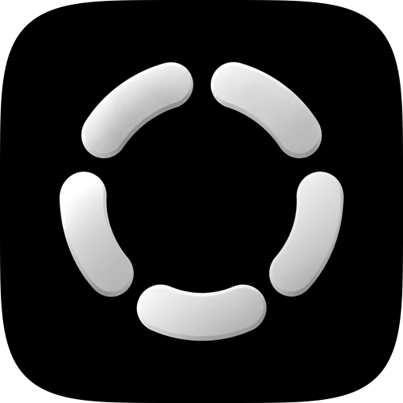
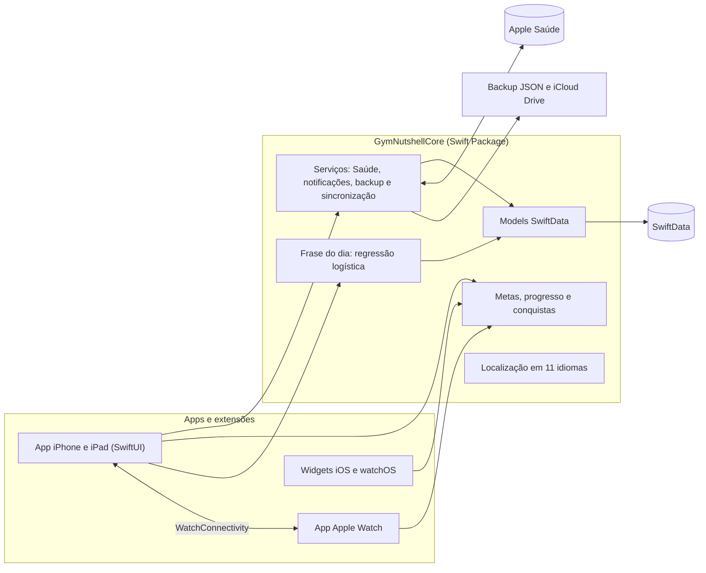
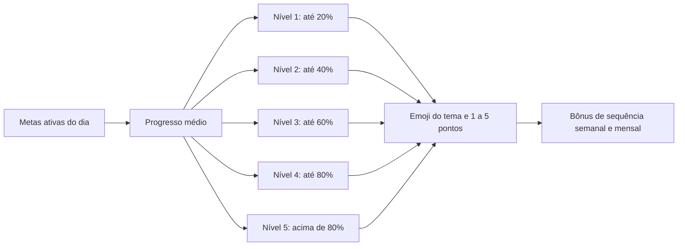
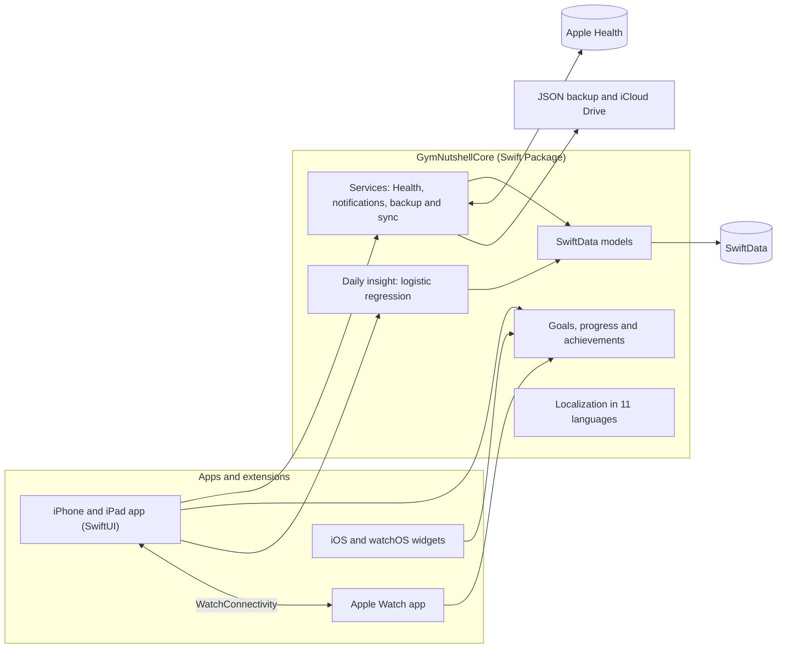
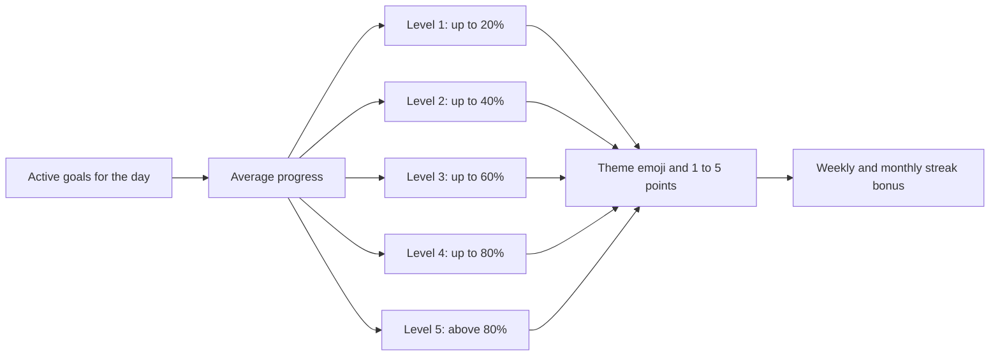

# &nbsp;&nbsp;Gym&nbsp;Nutshell&nbsp;&nbsp;

**[Read in English](#en-gymnutshell)**

_Rastreie metas de nutrição, sono, suplementos e libere conquistas._

O Nutshell nasceu da minha rotina de academia. Eu precisava lembrar de bater as metas de proteínas, carboidratos, água, sono e outros em um só lugar, mas não achei nenhum app que fizesse tudo isso junto.

Durante o dia, você rastreia cada meta com um slider simples, incluindo as metas padrões e outras metas personalizáveis, e recebe notificações ao longo do dia.

Para deixar o app um pouco mais divertido, cada dia completo vira uma conquista temática, com sequências e um calendário do seu progresso.

Ele é grátis, sem anúncios, sem assinatura e sem cadastro.

**Disponível na [App Store](https://apps.apple.com/us/app/gym-nutshell/id6774739305)** para iPhone, iPad, Apple Watch e Mac com Apple Silicon.

## Funcionalidades - Versão 2.0

**Hoje**
- Data com a frase do dia, que mostra como o seu dia tende a ser (ver "Frase do dia com machine learning").
- Anel de progresso em cinco cores, com o emoji da conquista do dia no centro.
- Metas agrupadas em Essencial, Nutrição, Treino e Suplemento, em lista ou em grade com balões por categoria.
- Controle por slider ou por botões − e +, à escolha do usuário.
- Botão de dia de descanso no Treino e seletor Pendente | Feito nas metas de check-in, como os suplementos.
- Balões que explicam o anel, a conquista e a data com um toque.

**Boas-vindas**
- Configuração inicial em poucas etapas: objetivo e sexo, metas, controles, tema e permissões.
- Metas sugeridas já ajustáveis com − e + antes de começar.

**Metas**
- Metas prontas: musculação, cardio, sono, água, calorias, proteína, carboidrato, gordura boa, fibra e creatina.
- Valores sugeridos pelo objetivo (emagrecimento, se manter ou ganhar massa) e pelo sexo.
- Ao trocar de objetivo, recálculo opcional e proporcional às metas atuais.
- Metas e categorias personalizadas, com ícone próprio e tipo: padrão, com dia de descanso ou de check-in.
- Água em mililitros ou em onças fluidas, americanas ou britânicas.

**Conquistas e temas**
- Cinco níveis por dia, um para cada cor do anel (faixas de 20%).
- 19 temas em seis categorias (esporte, animais, elementos e natureza, progresso, herói e cosmos), cada um com seus emojis e nomes de nível, incluindo variações no feminino.
- Pontos por dia de 1 a 5, conforme o nível.
- Bônus de sequência semanais e mensais para quem mantém os níveis 4 e 5 todos os dias.
- Calendário mensal e histórico editável dos últimos 30 dias.
- Gráfico com a média de cada dia da semana.

**Registros**
- Dias registrados, pontos e bônus acumulados.
- Quantidade de dias em cada nível, atividade recente e últimos 7 dias.

**Frase do dia com machine learning**
- Um modelo de regressão logística, escrito em Swift e treinado no próprio aparelho, estima a chance de o dia ser fraco (60% ou menos das metas).
- Usa só o histórico do usuário: dia da semana, ontem, os últimos 7 dias, a sequência, o sono e o treino.
- A previsão só aparece quando acerta mais do que regras simples, como a média do dia da semana. Se não acertar, o app mostra essa média.
- Começa depois de 21 dias de registro. O balão da data mostra o que mais pesou no dia.
- Nada sai do aparelho: sem servidor e sem Core ML.

**Apple Watch**
- App próprio com o anel do dia, as metas, as estatísticas e o histórico de notificações.
- Sincronização nos dois sentidos com o iPhone.
- Complicações para o mostrador nos formatos circular, retangular, de canto e em linha.

**Widgets**
- Progresso (pequeno, médio e na tela bloqueada), Calendário e Metas (grandes), com o anel de cinco cores.
- Fundo do widget configurável.

**Apple Saúde**
- Leitura dos treinos para marcar musculação e cardio automaticamente.
- Registro das horas de sono no app Saúde.
- Permissões pedidas na configuração inicial ou depois, só para o que o usuário ativar.

**Lembretes**
- Notificações locais por meta, com intervalo configurável e horário limitado ao período do dia.
- Suplementos com horários fixos e o botão "Tomei" na própria notificação.
- Opção de agrupar os avisos no mesmo horário e de mostrar emojis nas notificações.
- Histórico das notificações recebidas.

**Dados e personalização**
- Backup em JSON para exportar e importar, compatível com a versão Android e com backups da 1.0.
- Backup automático diário no iCloud Drive.
- Cor de destaque e aparência clara, escura ou a do aparelho.
- Interface em 11 idiomas: português do Brasil, inglês (EUA e Reino Unido), espanhol, francês, alemão, italiano, japonês, coreano, chinês simplificado e turco.
- Suporte a VoiceOver.
- Disponível para iPhone, iPad e Mac com Apple Silicon.

## Arquitetura



- **SwiftUI** em toda a interface, no padrão **MV** (Model-View): o estado mora nas próprias views e em poucos stores `@Observable` por domínio, sem camada de ViewModel.
- Navegação por um único `NavigationStack` com um roteador `@Observable`: a tela Hoje é a raiz e Registros, Conquistas e Ajustes abrem como páginas.
- Visual Liquid Glass no iOS 26 ou superior, com alternativa sólida no iOS 18.
- **SwiftData** para persistência local.
- **GymNutshellCore**: Swift Package local compartilhado pelos cinco alvos (app iOS, app watchOS, widgets iOS, widgets watchOS e testes). Concentra models, cálculo de metas, conquistas, bônus, o modelo de machine learning, serviços e a localização, que é um catálogo único para todos os alvos.
- **HealthKit**, **WidgetKit**, **WatchConnectivity**, **AppIntents** e **UserNotifications** para a integração com o sistema.
- **Machine learning sem bibliotecas**: regressão logística com gradiente em lote, 15 variáveis só do passado, validação em ordem de data e comparação com duas regras simples. O treino roda no aparelho, com testes no Core.
- Anel de cinco cores desenhado com shapes do SwiftUI e gráfico por dia da semana com Swift Charts.
- Nenhuma dependência externa: apenas frameworks nativos da Apple.

### Do check-in à conquista



## Estrutura do repositório

```text
GymNutshell/
├── GymNutshellApp/            App iPhone e iPad
│   ├── Views/                 Telas por área: Hoje, Registros, Conquistas, Ajustes e boas-vindas
│   ├── Helpers/               Delegate do app e roteador da navegação
│   └── Resources/             Assets, Info.plist e textos do sistema localizados
├── GymNutshellWatch/          App Apple Watch
├── GymNutshellWidget/         Widgets do iPhone
├── GymNutshellWatchWidget/    Complicações do Apple Watch
├── GymNutshellCore/           Swift Package com o domínio do app
│   ├── Sources/GymNutshellCore/
│   │   ├── Models/            Registros diários, níveis, temas, categorias, perfil e backup
│   │   ├── Goals/             Metas padrão, cálculo das metas e ordem de exibição
│   │   ├── ML/                Frase do dia: variáveis, regressão logística e média por dia da semana
│   │   ├── Services/          Saúde, notificações, backup, iCloud, bônus e sincronização com o Watch
│   │   ├── Stores/            Metas personalizadas, categorias, preferências e dados dos widgets
│   │   ├── UI/                Anel de progresso compartilhado com o Watch e os widgets
│   │   ├── Accessibility/     Apoio ao VoiceOver
│   │   └── Resources/         Localização em 11 idiomas
│   └── Tests/                 Testes do Core
└── GymNutshell.xcodeproj
```

## Requisitos

- iOS 18 ou superior e watchOS 11 ou superior.
- Xcode com Swift 6.3 ou superior.

Para executar em um aparelho, selecione o seu Team e configure em **Signing & Capabilities** o HealthKit, o container do iCloud e o App Group usado pelos widgets.

## Privacidade

O Gym Nutshell não exige cadastro e não coleta dados. As informações ficam no próprio dispositivo e, quando o backup está ativo, no iCloud Drive do usuário. Os dados de saúde ficam no app Saúde e só são lidos ou gravados com a permissão do usuário. A frase do dia é calculada no próprio aparelho. Não há servidores próprios, ferramentas de análise ou anúncios.

## Android

Existe também uma versão nativa para Android, feita em Kotlin e Jetpack Compose: [gymnutshell-android](https://github.com/jonathaxs/gymnutshell-android).

## Autor

Desenvolvido por **Jonathas Motta** ([@jonathaxs](https://github.com/jonathaxs)).

---

# &nbsp;&nbsp;(EN) Gym&nbsp;Nutshell&nbsp;&nbsp;

**[Leia em português](#gymnutshell)**

_Track nutrition, sleep and supplement goals and unlock achievements._

Nutshell grew out of my gym routine. I needed to remember to hit my protein, carbs, water, sleep and other goals in one place, but I couldn't find an app that did all of that together.

During the day, you track each goal with a simple slider, including the default goals and your own custom ones, and get notifications throughout the day.

To make the app a bit more fun, every completed day becomes a themed achievement, with streaks and a calendar of your progress.

It's free, with no ads, no subscription and no sign-up.

**Available on the [App Store](https://apps.apple.com/us/app/gym-nutshell/id6774739305)** for iPhone, iPad, Apple Watch and Macs with Apple Silicon.

## Features - Version 2.0

**Today**
- The date with the daily insight, a line that shows how your day is likely to go (see "Daily insight with machine learning").
- A five-color progress ring, with the day's achievement emoji in the center.
- Goals grouped into Essential, Nutrition, Training and Supplement, as a list or as a grid with a popover per category.
- Slider or − and + buttons, whichever the user prefers.
- Rest day button for Training and a Pending | Done picker for check-in goals, such as supplements.
- Popovers that explain the ring, the achievement and the date with a tap.

**Welcome**
- A short first-run setup: goal and sex, goals, controls, theme and permissions.
- Suggested goals you can adjust with − and + before you start.

**Goals**
- Ready-made goals: weight training, cardio, sleep, water, calories, protein, carbs, healthy fats, fiber and creatine.
- Suggested values based on the goal (cutting, maintenance or bulking) and on sex.
- When the goal changes, an optional recalculation proportional to the current goals.
- Custom goals and categories, with their own icon and type: standard, with rest day or check-in.
- Water in milliliters or in US or UK fluid ounces.

**Achievements and themes**
- Five levels per day, one for each ring color (20% bands).
- 19 themes in six categories (sport, animals, elements and nature, progress, hero and cosmos), each with its own emojis and level names, including feminine versions.
- 1 to 5 points per day, based on the level.
- Weekly and monthly streak bonuses for keeping levels 4 and 5 every day.
- Monthly calendar and editable history for the last 30 days.
- Chart with the average for each weekday.

**Records**
- Logged days, points and bonuses earned.
- Number of days at each level, recent activity and the last 7 days.

**Daily insight with machine learning**
- A logistic regression model, written in Swift and trained on the device, estimates the chance of a weak day (60% of the goals or less).
- It only uses the user's own history: the weekday, yesterday, the last 7 days, the streak, sleep and workouts.
- The forecast only shows up when it beats simple rules, such as the weekday average. Otherwise, the app shows that average.
- It starts after 21 logged days. The date popover shows what weighed most that day.
- Nothing leaves the device: no server and no Core ML.

**Apple Watch**
- Its own app with the day's ring, goals, stats and notification history.
- Two-way sync with the iPhone.
- Watch face complications in circular, rectangular, corner and inline styles.

**Widgets**
- Progress (small, medium and Lock Screen), Calendar and Goals (large), with the five-color ring.
- Configurable widget background.

**Apple Health**
- Reads workouts to check off weight training and cardio automatically.
- Saves sleep hours to the Health app.
- Permissions are requested during setup or later, only for what the user turns on.

**Reminders**
- Local notifications per goal, with a configurable interval and limited to daytime hours.
- Supplements at fixed times, with a "Taken" button right in the notification.
- Options to group reminders at the same time and to show emojis in notifications.
- History of received notifications.

**Data and personalization**
- JSON backup to export and import, compatible with the Android version and with 1.0 backups.
- Automatic daily backup to iCloud Drive.
- Accent color and light, dark or device appearance.
- Interface in 11 languages: Brazilian Portuguese, English (US and UK), Spanish, French, German, Italian, Japanese, Korean, Simplified Chinese and Turkish.
- VoiceOver support.
- Available for iPhone, iPad and Macs with Apple Silicon.

## Architecture



- **SwiftUI** throughout the interface, using the **MV** (Model-View) pattern: state lives in the views themselves and in a few `@Observable` stores per domain, with no ViewModel layer.
- Navigation through a single `NavigationStack` with an `@Observable` router: Today is the root, and Records, Achievements and Settings open as pages.
- Liquid Glass look on iOS 26 or later, with a solid fallback on iOS 18.
- **SwiftData** for local persistence.
- **GymNutshellCore**: a local Swift Package shared by the five targets (iOS app, watchOS app, iOS widgets, watchOS widgets and tests). It holds the models, goal calculation, achievements, bonuses, the machine learning model, services and localization, which is a single catalog for every target.
- **HealthKit**, **WidgetKit**, **WatchConnectivity**, **AppIntents** and **UserNotifications** for system integration.
- **Machine learning with no libraries**: logistic regression with batch gradient descent, 15 past-only features, date-ordered validation and a comparison against two simple rules. Training runs on the device, with tests in the Core.
- Five-color ring drawn with SwiftUI shapes and a weekday chart with Swift Charts.
- No external dependencies: only Apple's native frameworks.

### From check-in to achievement



## Repository structure

```text
GymNutshell/
├── GymNutshellApp/            iPhone and iPad app
│   ├── Views/                 Screens by area: Today, Records, Achievements, Settings and welcome
│   ├── Helpers/               App delegate and navigation router
│   └── Resources/             Assets, Info.plist and localized system strings
├── GymNutshellWatch/          Apple Watch app
├── GymNutshellWidget/         iPhone widgets
├── GymNutshellWatchWidget/    Apple Watch complications
├── GymNutshellCore/           Swift Package with the app's domain
│   ├── Sources/GymNutshellCore/
│   │   ├── Models/            Daily records, levels, themes, categories, profile and backup
│   │   ├── Goals/             Default goals, goal calculation and display order
│   │   ├── ML/                Daily insight: features, logistic regression and weekday average
│   │   ├── Services/          Health, notifications, backup, iCloud, bonuses and Watch sync
│   │   ├── Stores/            Custom goals, categories, preferences and widget data
│   │   ├── UI/                Progress ring shared with the Watch and the widgets
│   │   ├── Accessibility/     VoiceOver support
│   │   └── Resources/         Localization in 11 languages
│   └── Tests/                 Core tests
└── GymNutshell.xcodeproj
```

## Requirements

- iOS 18 or later and watchOS 11 or later.
- Xcode with Swift 6.3 or later.

To run it on a device, select your Team and set up HealthKit, the iCloud container and the App Group used by the widgets in **Signing & Capabilities**.

## Privacy

Gym Nutshell requires no sign-up and collects no data. Information stays on the device and, when backup is on, in the user's iCloud Drive. Health data stays in the Health app and is only read or written with the user's permission. The daily insight is calculated on the device itself. There are no servers of its own, no analytics and no ads.

## Android

There is also a native Android version, built with Kotlin and Jetpack Compose: [gymnutshell-android](https://github.com/jonathaxs/gymnutshell-android).

## Author

Developed by **Jonathas Motta** ([@jonathaxs](https://github.com/jonathaxs)).
